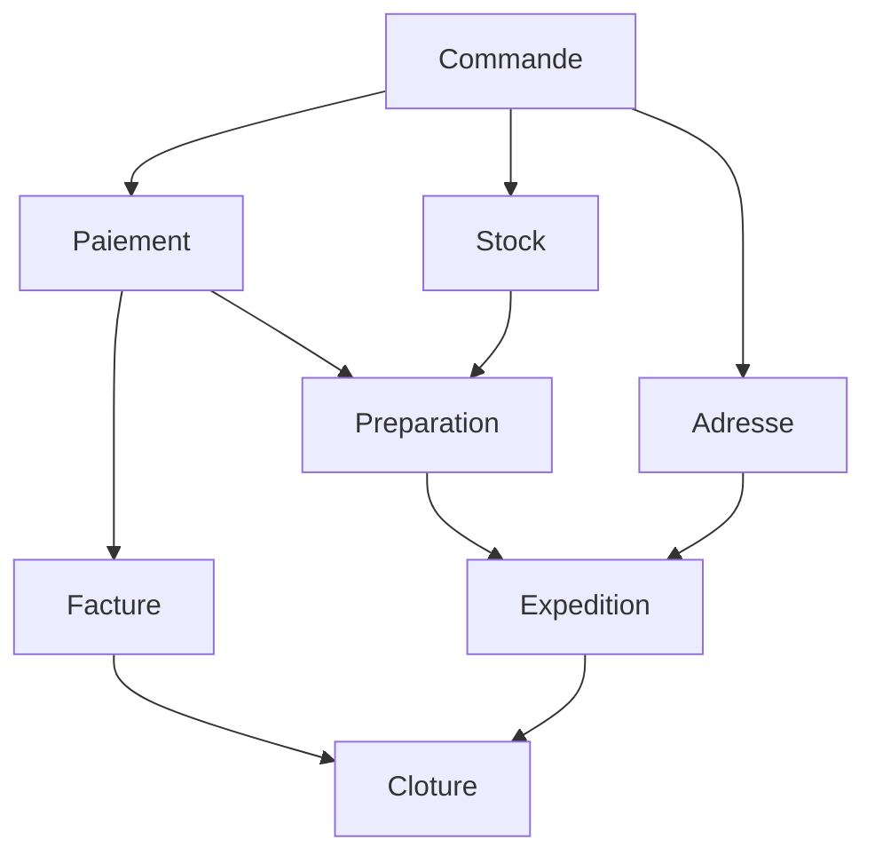

# petri-core

[](https://github.com/Lsh0x/petri-net/actions/workflows/ci.yml)
[](https://crates.io/crates/petri-core)
[](https://docs.rs/petri-core)
[](https://github.com/Lsh0x/petri-net/actions/workflows/ci.yml)
[](https://github.com/Lsh0x/petri-net/blob/main/LICENSE)

**Define task dependencies in YAML or JSON. The library compiles the graph,
issues authenticated task tokens and records progress atomically.**

No enums, numeric internal places, explicit fork nodes or hand-written Petri
arcs are required. Symbolic names connect tasks in the file; services use their
numeric `Id`. Business work, events, delays and scheduling belong to your code.

## Installation

The declarative API is introduced in 0.3. Until that release is available:

```toml
[dependencies]
petri-core = { git = "https://github.com/Lsh0x/petri-net" }
serde_json = "1"
```

The crate is runtime-independent. The runnable examples use `futures`' executor
as a dev dependency; production can use its existing async runtime.

## Define the graph

```yaml
Version: 1
Tasks:
  Commande:
    Id: 1
  Paiement:
    Id: 2
    DependsOn: Commande
  Stock:
    Id: 3
    DependsOn: Commande
  Adresse:
    Id: 4
    DependsOn: Commande
  Facture:
    Id: 5
    DependsOn: Paiement
  Preparation:
    Id: 6
    DependsOn: [Paiement, Stock]
  Expedition:
    Id: 7
    DependsOn: [Preparation, Adresse]
  Cloture:
    Id: 8
    DependsOn: [Expedition, Facture]
```

`DependsOn: A` and `DependsOn: [A, B]` mean that **all** named prerequisites
must finish in the same execution. Tasks without dependencies are initially
ready. Tasks with no dependents are terminal tasks. A run finishes only after
**every** task is complete, including independent terminal branches.



## Execute it in Rust

Here `yaml` contains the definition above. `start` returns ready root tokens;
`ready` discovers tasks whose dependencies have become satisfied.

```rust
use petri_core::engine::{Authenticator, MemoryStorage};
use petri_core::workflow::{Petri, Workflow};
use serde_json::json;
use std::sync::Arc;
# let yaml = "Version: 1\nTasks:\n  Commande:\n    Id: 1\n  Paiement:\n    Id: 2\n    DependsOn: Commande\n  Stock:\n    Id: 3\n    DependsOn: Commande\n  Adresse:\n    Id: 4\n    DependsOn: Commande\n  Facture:\n    Id: 5\n    DependsOn: Paiement\n  Preparation:\n    Id: 6\n    DependsOn: [Paiement, Stock]\n  Expedition:\n    Id: 7\n    DependsOn: [Preparation, Adresse]\n  Cloture:\n    Id: 8\n    DependsOn: [Expedition, Facture]\n";
# futures::executor::block_on(async {
let workflow = Workflow::from_yaml(yaml)?;
let storage = Arc::new(MemoryStorage::new());
// Demo only: provision a random 32-byte secret from secret management.
let auth = Arc::new(Authenticator::new([7; 32]));
let p = Petri::new(workflow, storage, auth)?;

let mut roots = p.start(1001, json!({"order": 1001})).await?;
let commande = roots.remove(0);
p.granted(&commande).await?;

// Your business code handles Commande here.
let receipt = p.executed(commande, json!({"accepted": true})).await?;
p.verify_completion(&receipt)?;

let ready = p.ready(1001).await?;
assert_eq!(ready.iter().map(|t| t.task_id()).collect::<Vec<_>>(), [2, 3, 4]);
# Ok::<(), petri_core::workflow::Error>(())
# }).unwrap();
```

Run **all three nontrivial example graphs** with:

```sh
cargo run --example declarative_workflow
```

The example prints each batch of tasks that can run in parallel, then records
their completion sequentially for readability. It does not spawn workers.

| Example | What it exercises |
| --- | --- |
| [Order YAML](https://github.com/Lsh0x/petri-net/blob/main/examples/workflows/order.yaml) | Payment feeding invoice and preparation, partial synchronization |
| [Media YAML](https://github.com/Lsh0x/petri-net/blob/main/examples/workflows/media.yaml) | Nested branches, crossed joins, early publication |
| [Deployment YAML](https://github.com/Lsh0x/petri-net/blob/main/examples/workflows/deploy.yaml) | Three independent roots, shared configuration, delayed archive branch |

## Service API

| Method | Meaning |
| --- | --- |
| `Workflow::from_yaml` / `from_json` | Parse and validate the same graph model |
| `Workflow::to_yaml` / `to_json` | Export the definition |
| `Workflow::task_id(name)` | Resolve a symbolic task name to a numeric ID |
| `Petri::new(workflow, storage, auth)` | Compile and bind the graph to an execution backend |
| `start(run_id, data)` | Atomically create all root activations |
| `ready(run_id)` | Return currently ready `TaskToken`s, ordered by numeric task ID |
| `granted(&token)` | Check task identity, prerequisite proofs and current availability |
| `executed(token, result)` | Recheck, atomically record completion and produce dependency tokens |
| `status(run_id)` | Revision, completed task IDs, ready tokens and `finished` |
| `snapshot` / `restore` | Export and restore authenticated execution state |

`granted` is advisory and does not reserve the task. `executed` verifies again
and returns a **completion receipt**, not an activation for the next task. Call
`ready` to obtain the next activations: there may be zero, one or many.

Ready tasks can appear in repeated reads until completed; this is not a queue
with claiming or lease semantics. Multiple workers may do business work after
an advisory check, but only one can record completion. Use business idempotency
where external effects require it.

A non-root token exposes `input(prerequisite_id)` to read that prerequisite's
result. A root token exposes `initial_data()`. Task results are copied onto each
outgoing edge, so multiple dependents can independently use them. Keep payloads
small and use external references for large results.

## Transport between services

The graph and task tokens are portable JSON. Services share the authoritative
store and authentication secret. Separate `MemoryStorage` instances are not a
shared backend across processes.

```rust
# use petri_core::engine::{Authenticator, MemoryStorage};
# use petri_core::workflow::{Petri, Workflow, TaskToken};
# use serde_json::json;
# use std::sync::Arc;
# let yaml = "Version: 1\nTasks:\n  Commande:\n    Id: 1\n  Paiement:\n    Id: 2\n    DependsOn: Commande\n  Stock:\n    Id: 3\n    DependsOn: Commande\n  Adresse:\n    Id: 4\n    DependsOn: Commande\n  Facture:\n    Id: 5\n    DependsOn: Paiement\n  Preparation:\n    Id: 6\n    DependsOn: [Paiement, Stock]\n  Expedition:\n    Id: 7\n    DependsOn: [Preparation, Adresse]\n  Cloture:\n    Id: 8\n    DependsOn: [Expedition, Facture]\n";
# futures::executor::block_on(async {
# let workflow = Workflow::from_yaml(yaml)?;
# let storage = Arc::new(MemoryStorage::new());
# let auth = Arc::new(Authenticator::new([7;32]));
# let p = Petri::new(workflow, storage.clone(), auth.clone())?;
# let root = p.start(1001, json!({"order":1001})).await?.remove(0);
# p.executed(root, json!({"accepted":true})).await?;
let payment = p.ready(1001).await?.into_iter()
    .find(|token| token.task_id() == 2).unwrap();
let token_json = payment.to_json()?;
let graph_json = p.workflow().to_json()?;

// On another trusted service using the same authoritative backend:
let worker = Petri::new(Workflow::from_json(&graph_json)?, storage, auth)?;
let token = TaskToken::from_json(&token_json)?;
worker.granted(&token).await?; // Parsing alone does not authenticate the token.
assert_eq!(token.input(1), Some(&json!({"accepted": true})));

// Perform payment, then record its declared completion.
worker.executed(token, json!({"paid": true})).await?;
# Ok::<(), petri_core::workflow::Error>(())
# }).unwrap();
```

## How the compiler handles crossed dependencies

The compiler creates an internal place for **each dependency edge**, an entry
place for each root, and a persistent completion marker for each task.

Completing a task consumes its prerequisite tokens and produces:

1. One authenticated token for **every dependent**, carrying the result.
2. One authenticated completion marker, retained in the marking.

For example, finishing `Paiement` creates separate tokens for `Facture` and
`Preparation`. Consuming the invoice's token cannot steal the preparation's
proof. A crossed join accepts the exact input places required by its task from
the same run; it does not require equal fork stacks.

This correlation policy is encoded in the compiled definition and therefore in
its authenticated identity. It is used only for these validated DAGs, where
each task can finish once per execution. The existing low-level engine's
structured fork-stack semantics remain the default for manually defined nets.

IDs and dependency edges determine compilation deterministically; declaration
order and the order of a `DependsOn` list do not change compiled identity.
Descriptions are display metadata, not execution conditions.

## Validation and boundaries

The parser rejects unknown fields, duplicate task names or IDs, missing
prerequisites, duplicate dependencies, self-dependencies and cycles (including
disconnected cycles). `Version` must be 1; `Id` is a `u32`. Optional
`Description` is display text. There are no `Type`, `WaitFor` or business rules.

Limits: 4 MiB input, 1024 tasks and 4096 compiled places. The underlying engine
also bounds active tokens and serialized state. Graphs are **acyclic and
all-dependencies/AND** in this format. Loops, conditional/XOR routes, dynamic
fan-out and wait-any/quorum joins are not inferred or silently approximated.
Use a future explicit occurrence/routing format for those semantics.

`TaskToken` task/run/dependency headers are checked against the compiled task;
embedded proofs are authenticated and must still be active. HMAC-SHA-256 covers
token origin, exact compiled definition, run, position, lineage and payload.
A stale or forged ticket cannot advance current authoritative state.

Storage must provide per-run atomic compare-and-swap and authoritative reads.
Conflicts return errors rather than silently retrying business work. Independent
tasks can also conflict if committed concurrently against the same revision;
reconcile/reload and explicitly retry the state transition when appropriate.

Snapshots use the same compiled identity and secret. Restore inserts only into
an absent run and never overwrites current state. An old authentic snapshot is
not proof of freshness: recovery requires a trusted checkpoint and retaining
run history/tombstones. All HMAC key holders are trusted issuers; business
execution itself is the service's responsibility.

## Optional tiercache archives

With `features = ["tiercache"]`, `archive(run, &cache)` and
`read_archive(run, revision, &cache)` expose authenticated immutable snapshots.
These are historical views. `granted` and `executed` always consult authoritative
`Storage`; cache hits cannot authorize execution or revive consumed tokens.

## Tests and lower-level APIs

```sh
cargo fmt --check
cargo clippy --locked --all-targets --all-features -- -D warnings
cargo test --locked --all-targets --all-features
cargo test --locked --no-default-features --all-targets
cargo test --locked --doc --all-features
cargo run --locked --example declarative_workflow
```

The new tests execute all three example graphs, transport tokens between engine
instances, verify restoration and reject forged/replayed tickets. Property tests
compare random DAG execution against an independent prerequisite scheduler after
every step. Existing authentication, concurrency and low-level Petri tests are
retained. CI requires 95% source line coverage and exports HTML/LCOV reports.

The [low-level engine guide](https://github.com/Lsh0x/petri-net/blob/main/docs/engine.md)
documents weighted arcs, structured loops, storage and authentication. The
[legacy data model](https://github.com/Lsh0x/petri-net/blob/main/docs/legacy-model.md)
remains available for compatibility and does not enforce engine guarantees.

Use `petri_core::workflow::Petri` (also `WorkflowPetri` at the root) for task
files. `petri_core::engine::Petri` and the root `Petri` remain the low-level API.

## License

[MIT](https://github.com/Lsh0x/petri-net/blob/main/LICENSE).
