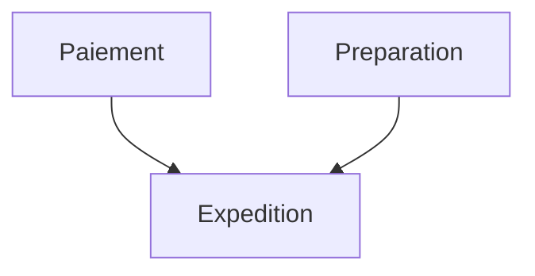

# petri-core

[](https://github.com/Lsh0x/petri-net/actions/workflows/ci.yml)
[](https://crates.io/crates/petri-core)
[](https://docs.rs/petri-core)
[](https://github.com/Lsh0x/petri-net/actions/workflows/ci.yml)
[](https://github.com/Lsh0x/petri-net/blob/main/LICENSE)

**Define a task graph in YAML or JSON. The Petri controls which tasks may run
and records their completion. Your services own all business data.**

The authenticated engine transports execution proofs only. There is no initial
business payload, result JSON, `input()` or `initial_data()` in its API.
JSON remains the serialization format for graph definitions, proof tokens and
snapshots; it is not a business-data channel.

## Installation

The payload-free API is introduced in 0.4. Until that release is available:

```toml
[dependencies]
petri-core = { git = "https://github.com/Lsh0x/petri-net" }
```

The library is async-runtime-independent. Examples use `futures`' executor as a
dev dependency; use your existing runtime in production.

## Small example: pay, prepare, ship

Payment and preparation can run independently. Shipping is authorized only
after **both** tasks have declared completion for the same execution.

```yaml
Version: 1
Tasks:
  Paiement:
    Id: 1
  Preparation:
    Id: 2
  Expedition:
    Id: 3
    DependsOn: [Paiement, Preparation]
```



Each business function receives the Petri, its proof token, and the application's
own order object. The order is never stored in a Petri token or snapshot.
`granted_for` also checks that the function received the expected task ID.

```rust
# const YAML: &str = "Version: 1\nTasks:\n  Paiement:\n    Id: 1\n  Preparation:\n    Id: 2\n  Expedition:\n    Id: 3\n    DependsOn: [Paiement, Preparation]\n";
use petri_core::engine::{Authenticator, MemoryStorage};
use petri_core::workflow::{Petri, TaskToken, Workflow};
use std::sync::Arc;

type Moteur = Petri<MemoryStorage>;
type Result<T> = std::result::Result<T, Box<dyn std::error::Error>>;

struct Commande {
    numero: u64,
    montant_centimes: u64,
    payee: bool,
    preparee: bool,
    expediee: bool,
}

async fn payer(p: &Moteur, token: TaskToken, commande: &mut Commande) -> Result<()> {
    p.granted_for(1, &token).await?;
    // Business code: in production, call your payment provider here.
    if commande.montant_centimes == 0 {
        return Err("le montant doit être positif".into());
    }
    println!("Paiement de {} centimes accepté", commande.montant_centimes);
    commande.payee = true;
    p.executed(token).await?;
    Ok(())
}

async fn preparer(p: &Moteur, token: TaskToken, commande: &mut Commande) -> Result<()> {
    p.granted_for(2, &token).await?;
    // Business code: reserve products and prepare the parcel.
    println!("Colis de la commande {} préparé", commande.numero);
    commande.preparee = true;
    p.executed(token).await?;
    Ok(())
}

async fn expedier(p: &Moteur, token: TaskToken, commande: &mut Commande) -> Result<()> {
    p.granted_for(3, &token).await?;
    // Business code: hand the parcel to the carrier.
    println!("Commande {} expédiée", commande.numero);
    commande.expediee = true;
    p.executed(token).await?;
    Ok(())
}

async fn traiter(p: &Moteur, run: u128, commande: &mut Commande) -> Result<()> {
    p.start(run).await?; // Execution ID only. No business payload.
    while !p.status(run).await?.finished {
        for token in p.ready(run).await? {
            match token.task_id() {
                1 => payer(p, token, commande).await?,
                2 => preparer(p, token, commande).await?,
                3 => expedier(p, token, commande).await?,
                _ => unreachable!("validated workflow contains three known tasks"),
            }
        }
    }
    Ok(())
}

fn moteur() -> Result<Moteur> {
    Ok(Petri::new(
        Workflow::from_yaml(YAML)?,
        Arc::new(MemoryStorage::new()),
        Arc::new(Authenticator::new([7; 32])), // Demo key only.
    )?)
}

fn main() -> Result<()> {
    futures::executor::block_on(async {
        let p = moteur()?;
        // Application data, never passed to the Petri constructor or tokens.
        let mut commande = Commande {
            numero: 1001,
            montant_centimes: 2500,
            payee: false,
            preparee: false,
            expediee: false,
        };
        traiter(&p, 42, &mut commande).await?;
        assert!(commande.payee && commande.preparee && commande.expediee);
        Ok(())
    })
}
```

Runnable source:
[`examples/commande.rs`](https://github.com/Lsh0x/petri-net/blob/main/examples/commande.rs).

```sh
cargo run --example commande
```

The example uses an execution ID of `42` and a business order number of `1001`
to show that these are separate concerns. `start(42)` creates the execution and
its initial proof tokens; no order ID or business data is passed to the engine.

The dispatcher is sequential for readability. A real application can dispatch
payment and preparation to separate services, each resolving its business data
from its own storage. The application maintains the mapping from execution IDs
to business records; the Petri does not manage that mapping.

## API

```rust
# use petri_core::engine::{Authenticator, MemoryStorage};
# use petri_core::workflow::{Petri, Workflow};
# use std::sync::Arc;
# futures::executor::block_on(async {
let graph = Workflow::from_yaml("Version: 1\nTasks: {A: {Id: 1}}")?;
let p = Petri::new(graph, Arc::new(MemoryStorage::new()),
    Arc::new(Authenticator::new([7; 32])))?; // Demo key only.

let token = p.start(42).await?.remove(0);
p.granted(&token).await?;
// Your business work goes here, outside the library.
let receipt = p.executed(token).await?;
p.verify_completion(&receipt)?;
assert!(p.status(42).await?.finished);
# Ok::<(), petri_core::workflow::Error>(())
# }).unwrap();
```

| Method | Meaning |
| --- | --- |
| `Workflow::from_yaml` / `from_json` | Parse and validate the same dependency graph |
| `Workflow::to_yaml` / `to_json` | Export the definition |
| `Workflow::task_id(name)` | Resolve a symbolic name to its numeric ID |
| `start(run_id)` | Atomically create all ready root activations |
| `ready(run_id)` | Discover currently authorized tasks, ordered by numeric ID |
| `granted(&token)` | Check identity, prerequisite proofs and current availability |
| `granted_for(task_id, &token)` | Also check the service's expected task ID |
| `executed(token)` | Atomically record completion and create dependent proof tokens |
| `status(run_id)` | Revision, completed IDs, ready tokens and completion status |
| `snapshot` / `restore` | Export and recover authenticated execution state |

`executed` returns an authenticated completion receipt, not a business result
and not necessarily the next activation. Call `ready` to discover the next
tasks: there may be zero, one or many. Completion receipts identify the task
and execution only; tokens also carry the graph identity, position and lineage
required for verification.

## More complex graphs

`DependsOn: A` and `DependsOn: [A, B]` wait for **all** listed prerequisites.
Tasks without dependencies are initially ready. Every terminal branch must
complete before the execution is finished.

| Example | Behaviour |
| --- | --- |
| [Order](https://github.com/Lsh0x/petri-net/blob/main/examples/workflows/order.yaml) | Shared payment prerequisite for invoice and preparation |
| [Media](https://github.com/Lsh0x/petri-net/blob/main/examples/workflows/media.yaml) | Nested branches, crossed joins and early publication |
| [Deployment](https://github.com/Lsh0x/petri-net/blob/main/examples/workflows/deploy.yaml) | Independent roots and multiple synchronization points |

```sh
cargo run --example declarative_workflow
```

The compiler creates one internal place per dependency edge, one entry place
per root and a persistent completion marker per task. Completing a task creates
separate proofs for each dependent. Two dependents cannot steal each other's
prerequisite token. A crossed join checks its exact prerequisite positions and
execution identity rather than requiring identical fork stacks.

Compilation is deterministic across declaration/dependency ordering. Task IDs
and graph edges determine execution identity. Optional `Description` fields
are display metadata. Internal places, arcs and fork nodes need not be written
in the input file.

## Business responsibility and concurrency

A task token authorizes workflow progression. It cannot prove that a payment,
HTTP call or other business operation really happened; the service declares
completion after performing that work.

`granted` and `granted_for` are advisory and do not reserve a task. `executed`
rechecks active inputs and commits using a per-run atomic compare-and-swap.
Only one competing consumption can commit, but several workers could perform
business effects after advisory checks. Services must supply business
idempotency where needed.

A business error before `executed` leaves the task pending. A commit conflict
after business work requires application reconciliation and an explicit retry
of workflow completion, not blindly repeating the external business action.
Uncertain storage/network failures likewise require reading authoritative state.

## Microservices, storage and transport

Task tokens are portable proof envelopes. Parsing alone does not verify them:
call `granted`/`granted_for` against the current authoritative store before
acting. Expected task IDs are checked before a service's business work.

```rust
# use petri_core::engine::{Authenticator, MemoryStorage};
# use petri_core::workflow::{Petri, Workflow, TaskToken};
# use std::sync::Arc;
# futures::executor::block_on(async {
# let graph = Workflow::from_yaml("Version: 1\nTasks: {A: {Id: 1}}")?;
# let storage = Arc::new(MemoryStorage::new());
# let auth = Arc::new(Authenticator::new([7;32]));
# let p = Petri::new(graph.clone(), storage.clone(), auth.clone())?;
let token = p.start(42).await?.remove(0);
let json = token.to_json()?;

// Another engine instance, with the same graph, store and separately provisioned key:
let worker = Petri::new(Workflow::from_json(&graph.to_json()?)?, storage, auth)?;
let token = TaskToken::from_json(&json)?;
worker.granted_for(1, &token).await?;
// Resolve and process business data using your application's own mechanism.
worker.executed(token).await?;
# Ok::<(), petri_core::workflow::Error>(())
# }).unwrap();
```

`MemoryStorage` coordinates engines sharing the same `Arc`, within one process.
For real microservices, implement `engine::Storage` using an authoritative
shared backend with atomic per-run CAS; a separate `get` followed by `put`
is insufficient. Retain completed runs or tombstones and never reuse a run ID.
Independent restored copies do not coordinate.

The optional `tiercache` feature archives immutable revision snapshots via
`archive` and `read_archive`. Archives are historical views; authorization
always reads authoritative `Storage`, never a cached revision.

## Validation, authentication and limits

The graph parser rejects unknown fields, duplicate names or IDs, unknown or
duplicate prerequisites, self-dependencies and cycles, including disconnected
cycles. `Version` must be 1 and task IDs are `u32`. The declarative format
supports acyclic, all-dependencies/AND graphs; conditional routing, dynamic
fan-out, loops and wait-any joins are not silently approximated. Events and
waiting remain application responsibilities.

Limits: 4 MiB serialized input/state, 1024 tasks and 4096 compiled places.
The engine bounds active tokens and uses checked allocation/revision counters.
Enforce incoming request-size limits before buffering network input as well.

Execution tokens and snapshots use domain-separated HMAC-SHA-256 over their
execution claims. Supply a securely generated 32-byte secret; the fixed example
key is only for demonstrations. Every HMAC key holder is a trusted issuer.
This is not a public-key signature scheme. Secrets are never exported.

Snapshots authenticate the current marking, revision and counters. Restore
verifies consistency and inserts only if that run is absent; it never overwrites
an existing run. Authenticity is not freshness: recovery must use a trusted
checkpoint and preserve run history. No guarantee can survive deliberate
rollback by the authoritative store.

## Migration from 0.3

Version 0.4 removes business data from both `workflow` and the authenticated
`engine` APIs. Remove the data argument from `start`, the result argument from
`executed`, and the output-payload vector from low-level `execute`. There is no
`start_with_data`, token `data`/`input`/`initial_data`, or receipt `result` method.

Authenticated proof/definition serialization now uses schema version **2** and
new MAC/cache domains. Old payload-bearing tokens and snapshots are rejected;
there is no automatic migration or re-signing of old execution state. YAML task
definitions continue to use `Version: 1` and can be parsed unchanged.

The original 0.1 generic data containers remain isolated compatibility types;
they are not authenticated workflow credentials. The root `Petri` is still the
low-level engine; use `workflow::Petri` or the `WorkflowPetri` alias for task files.

## Tests and guides

```sh
cargo fmt --check
cargo clippy --locked --all-targets --all-features -- -D warnings
cargo test --locked --all-targets --all-features
cargo test --locked --no-default-features --all-targets
cargo test --locked --doc --all-features
cargo run --locked --example commande
```

Tests cover graphs and crossed joins, generated-DAG/reference-model comparisons,
forged/replayed proofs, atomic concurrency, recovery and payload-free exports.
The order example also tests rejected payments, incorrect task dispatch and both
branch completion orders. CI enforces 95% source line coverage and exports
HTML/LCOV reports. Coverage is not a security audit.

See the [low-level engine guide](https://github.com/Lsh0x/petri-net/blob/main/docs/engine.md)
and the separate [legacy data-model guide](https://github.com/Lsh0x/petri-net/blob/main/docs/legacy-model.md).

## License

[MIT](https://github.com/Lsh0x/petri-net/blob/main/LICENSE).
