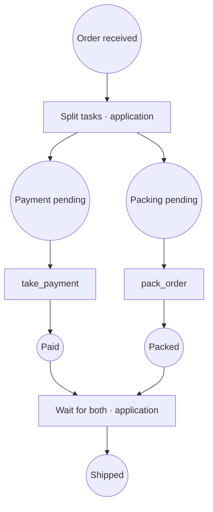

# petri-core

[](https://github.com/Lsh0x/petri-net/actions/workflows/ci.yml)
[](https://crates.io/crates/petri-core)
[](https://docs.rs/petri-core)
[](https://github.com/Lsh0x/petri-net/actions/workflows/ci.yml)
[](https://github.com/Lsh0x/petri-net/blob/main/LICENSE)

**Generic places, transitions, tokens and markings for Rust.**

A small, synchronous data model for **state-machine Petri nets**.
Attach your own metadata to places, transitions and tokens, inspect enabled
transitions, and move tokens explicitly.

> Initial development: the package is named `petri-core`, while this repository
> is named `petri-net`. Version `0.1.0` is available on crates.io.

## Installation

Add the crate to your application:

```toml
[dependencies]
petri-core = "0.1"
```

The Rust import is `petri_core`. Serde support is always enabled; there are
currently no optional feature flags.

## What it does

The core stores the net's definition and current marking. Your application
provides the domain meaning: a place might represent a workflow stage, a
transition an allowed action, and a token an individual job.

Each transition connects **one source place to one destination place**.
It is enabled when its source contains at least one token. Querying enabled
transitions is pure: it neither consumes tokens nor evaluates application rules.

This is the state-machine subset of Petri nets. Multi-input joins, multi-output
forks, weighted arcs and automatic firing are outside the current API.

## Quick start

```rust
use petri_core::{Definition, Marking, Place, Token, Transition};

let net = Definition::new(
    vec![Place::new("pending", ()), Place::new("done", ())],
    vec![Transition::new("complete", "pending", "done", ())],
);

let pending = "pending".to_string();
let done = "done".to_string();
let mut marking = Marking::new();
marking.put_token(pending.clone(), Token::new(1, pending.clone(), "job-001"));

assert_eq!(net.enabled_transitions(&marking)[0].id, "complete");

let moved = marking.move_token(&pending, done.clone(), 1).unwrap();
assert_eq!(moved.data, "job-001");
assert_eq!(moved.place_id, done);
assert!(marking.tokens_in(&pending).is_empty());
assert!(net.enabled_transitions(&marking).is_empty());
```

Run the sequential example with `cargo run --example workflow`.

## Example: payment and packing in parallel

An order can be packed while its payment is being processed. Shipping must wait
for **both** tasks to finish for that same order.



Circles represent places. `take_payment` and `pack_order` are core transitions.
The split and AND barrier are application code, explicitly demonstrated in
[`examples/parallel_order.rs`](examples/parallel_order.rs).

1. Insert one order token in `received`.
2. The application consumes it and creates two tokens with the same order
   number: one in `payment_pending`, one in `packing_pending`.
3. Both transitions are enabled. Each branch advances independently, in either
   order. The core itself does not spawn threads or execute external tasks.
4. After packing finishes, shipping is still blocked if payment is pending.
5. Once both completion tokens exist for the same order, the application
   consumes them and inserts one token in `shipped`.

The complete implementation below corresponds to the diagram. Copy it into
`src/main.rs` of an application depending on `petri-core`, or run the example
already included in this repository.

```rust
use petri_core::{Definition, Marking, Place, Token, Transition};

#[derive(Debug, Clone, PartialEq, Eq)]
struct Order {
    number: u64,
}

fn complete(net: &Definition, marking: &mut Marking<Order>, transition: &str, token: u64) {
    let transition = net.transition(transition).expect("known transition");
    assert!(net.enabled_transitions(marking).contains(&transition));
    marking
        .move_token(&transition.from, transition.to.clone(), token)
        .expect("token at source");
}

// Application-level AND barrier: both branches must finish for the same order.
fn try_ship(marking: &mut Marking<Order>, order: &Order) -> bool {
    let paid = "paid".to_string();
    let packed = "packed".to_string();
    let payment = marking.tokens_in(&paid).iter().find(|t| &t.data == order);
    let packing = marking.tokens_in(&packed).iter().find(|t| &t.data == order);
    let (Some(payment), Some(packing)) = (payment, packing) else {
        return false;
    };
    let (payment_id, packing_id) = (payment.id, packing.id);
    marking.remove_token(&paid, payment_id).unwrap();
    marking.remove_token(&packed, packing_id).unwrap();
    marking.put_token("shipped".into(), Token::new(4, "shipped", order.clone()));
    true
}

fn main() {
    let net = Definition::new(
        [
            "received",
            "payment_pending",
            "packing_pending",
            "paid",
            "packed",
            "shipped",
        ]
        .into_iter()
        .map(|id| Place::new(id, ()))
        .collect(),
        vec![
            Transition::new("take_payment", "payment_pending", "paid", ()),
            Transition::new("pack_order", "packing_pending", "packed", ()),
        ],
    );
    let order = Order { number: 1001 };
    let mut marking = Marking::new();
    marking.put_token("received".into(), Token::new(1, "received", order.clone()));

    // Application-level split: consume the received order, create two tasks.
    let received = marking.remove_token(&"received".into(), 1).unwrap();
    marking.put_token(
        "payment_pending".into(),
        Token::new(2, "payment_pending", received.data.clone()),
    );
    marking.put_token(
        "packing_pending".into(),
        Token::new(3, "packing_pending", received.data),
    );
    assert_eq!(net.enabled_transitions(&marking).len(), 2);
    println!("Order 1001: payment and packing are both enabled.");

    // Packing can finish before payment. These steps may complete in either order.
    complete(&net, &mut marking, "pack_order", 3);
    assert!(!try_ship(&mut marking, &order));
    assert_eq!(marking.tokens_in(&"packed".into()).len(), 1);
    println!("Packed, but payment is pending: shipping is blocked.");

    complete(&net, &mut marking, "take_payment", 2);
    assert!(try_ship(&mut marking, &order));
    assert!(marking.tokens_in(&"paid".into()).is_empty());
    assert!(marking.tokens_in(&"packed".into()).is_empty());
    assert_eq!(marking.tokens_in(&"shipped".into())[0].data, order);
    assert!(!try_ship(&mut marking, &order));
    println!("Paid and packed: branch tokens consumed, order shipped once.");
}
```

```sh
cargo run --example parallel_order
```

Expected output:

```text
Order 1001: payment and packing are both enabled.
Packed, but payment is pending: shipping is blocked.
Paid and packed: branch tokens consumed, order shipped once.
```

The example checks the intermediate markings and tests that different orders
cannot satisfy each other's barrier. It is a single-process demonstration with
caller-managed token IDs. In a real concurrent application, perform the split
and barrier under one lock or transaction and allocate unique token IDs.

**Two outgoing transitions from one place do not create parallel tasks.** With
one token they are alternatives: moving that token takes only one path. This
example creates two tokens explicitly. Native multi-input/multi-output firing
would require a richer transition model than the current `from`/`to` API.

## Bring your own data

The three payload types are independent and default to `()`:

```rust
use petri_core::{Place, Token, Transition};

struct Stage {
    label: String,
}

let pending = Place::new("pending", Stage { label: "Pending review".into() });
let approve = Transition::new("approve", "pending", "approved", "reviewer");
let job = Token::new(42, pending.id.clone(), vec!["document.pdf"]);

assert_eq!(pending.data.label, "Pending review");
assert_eq!(approve.data, "reviewer");
assert_eq!(job.data, vec!["document.pdf"]);
```

Payloads need no trait bounds for construction, insertion, removal or queries.
Cloning, equality, hashing and serialization require the corresponding traits
on the payload when those operations are used. `move_token` requires
`D: Clone` because it returns a snapshot while retaining the moved token.

## Core API

| Type | Responsibility |
| --- | --- |
| `Place<P = ()>` | String ID and place metadata |
| `Transition<T = ()>` | String ID, source, destination and transition metadata |
| `Token<D = ()>` | Caller-assigned `u64` ID, place ID and payload |
| `Marking<D = ()>` | Tokens grouped by place |
| `Definition<P = (), T = ()>` | Places, transitions and lookup/query methods |

`PlaceId` and `TransId` are aliases for `String`. All types are re-exported at
the crate root and remain available in their respective modules.

### Markings

| Method | Behavior |
| --- | --- |
| `tokens_in(&place)` | Returns a borrowed slice, empty for an unknown place |
| `put_token(place, token)` | Inserts a token and normalizes its `place_id` |
| `remove_token(&place, id)` | Removes the first matching token, or returns `None` |
| `move_token(&from, to, id)` | Moves a token and returns its snapshot, or `None` |

Removing the last token also removes the empty bucket. A missing token leaves
the marking unchanged, and moving a token to its existing place is supported.

### Definitions

`place(id)` and `transition(id)` return the first matching definition.
`enabled_transitions(&marking)` returns borrowed transitions in definition order.

Moving a token is a marking operation: it does not look up a transition or
check whether the move is allowed by a definition. Perform domain checks in
your application before moving it.

## Serialization

All model types derive Serde's `Serialize` and `Deserialize`.
For JSON, add `serde_json` to your application:

```rust
use petri_core::{Marking, Token};

let mut marking = Marking::new();
marking.put_token("pending".into(), Token::new(1, "pending", "job-001"));

let json = serde_json::to_string(&marking).unwrap();
let restored: Marking<String> = serde_json::from_str(&json).unwrap();
assert_eq!(restored.tokens_in(&"pending".into())[0].data, "job-001");
```

## Current guarantees and limits

- Token IDs are managed by the caller; uniqueness is not enforced.
- Definitions accept duplicate IDs and dangling transition endpoints.
- Markings accept places that are absent from a definition.
- Deserialization assumes consistent input; it does not validate token bucket
  keys against each token's `place_id`.
- Source occupancy is the only enabling condition. Guards, permissions,
  capacity, deadlines, persistence and scheduling belong to the application.
- No minimum supported Rust version is claimed yet. CI uses stable Rust.

These constraints keep this first version aligned with a generic data model;
applications must validate untrusted definitions and markings before using them.

## Development

```sh
cargo fmt --check
cargo clippy --all-targets --all-features -- -D warnings
cargo test --all-targets --all-features
cargo test --doc --all-features
RUSTDOCFLAGS="-D warnings" cargo doc --no-deps --all-features
cargo run --example workflow
```

CI enforces formatting, Clippy, tests, executable examples, rustdoc,
dependency advisories and license/source checks, plus LLVM coverage.
LCOV is saved as a workflow artifact. Codecov uploads use the optional
`CODECOV_TOKEN` secret and do not block CI if the upload fails.
There are no benchmark targets or feature combinations to test yet.

## Tests and coverage

The suite includes **30 tests** (24 deterministic core tests, four property tests,
and two parallel-workflow example tests), plus four executable documentation
examples. Each property test runs 256 generated cases per invocation.

Coverage includes missing tokens and buckets, duplicate IDs, self-moves,
empty/Unicode/long IDs, `u64::MAX`, non-clone payloads, clone isolation,
malformed JSON, documented permissive deserialization, and a 10,000-token case.
Random operation sequences are compared with an independent flat-list model;
after each operation every bucket and token count must agree. Separate
properties verify serialization, failed-operation atomicity and enabling rules.

Measured source coverage is **100% of lines, functions and regions** with stable
Rust and `cargo-llvm-cov`. This measures executed code, not all possible inputs;
LLVM branch coverage is not enabled. Tests explicitly preserve current API
semantics, including acceptance of duplicate IDs and unchecked definitions.

```sh
cargo install cargo-llvm-cov --locked
rustup component add llvm-tools-preview
cargo llvm-cov --locked --tests --all-features --workspace --no-report
cargo llvm-cov report --ignore-filename-regex '/(tests|examples)/' --summary-only --fail-under-lines 95
cargo llvm-cov report --ignore-filename-regex '/(tests|examples)/' --html --output-dir coverage
```

CI fails below **95% source line coverage**. The `coverage` Actions artifact
contains LCOV, a text summary and an HTML report; coverage excludes test and
example source files. The example tests still run in the regular test job.

## Releases

Release-plz runs on pushes to `main` and can also be started manually from
GitHub Actions. It manages release pull requests, changelogs, semantic-version
checks, publication to crates.io, tags and GitHub releases.

Publishing requires a scoped `CARGO_REGISTRY_TOKEN` repository secret with
permission to publish this crate. The workflow fails with an explicit message
if the secret is missing. The crate name must be available on crates.io, or the
token's owner must own the existing crate.

For release pull requests, enable **Allow GitHub Actions to create and approve
pull requests** in the repository's Actions settings.

## License

Licensed under the [MIT License](https://github.com/Lsh0x/petri-net/blob/main/LICENSE).
