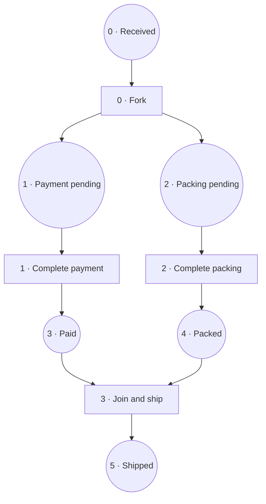

# petri-core

[](https://github.com/Lsh0x/petri-net/actions/workflows/ci.yml)
[](https://crates.io/crates/petri-core)
[](https://docs.rs/petri-core)
[](https://github.com/Lsh0x/petri-net/actions/workflows/ci.yml)
[](https://github.com/Lsh0x/petri-net/blob/main/LICENSE)

**Numeric Petri workflows with authenticated tokens, native forks/joins and
atomic state transitions over storage you provide.**

The `engine` module adds the execution guarantees discussed below. The original
root-level `Place`, `Transition`, `Token`, `Marking` and `Definition` types remain
plain data models for compatibility; they do **not** acquire engine security
properties. Use `petri_core::engine::*` for the new API. `Petri` is also
re-exported at the crate root.

## Installation

The engine is introduced in version 0.2. Until that release is available, use Git:

```toml
[dependencies]
petri-core = { git = "https://github.com/Lsh0x/petri-net" }
serde_json = "1"
# The example uses futures' executor; production can use an existing runtime.
futures = { version = "0.3", features = ["executor"] }
```

Enable `features = ["tiercache"]` for optional immutable snapshot archiving.
The library has no executor requirement of its own. No MSRV is claimed yet.

## Definition, marking and token

| Component | Meaning |
| --- | --- |
| `Definition` | Versioned numeric places, initial place, weighted transitions; exportable as JSON |
| `Snapshot` | Authenticated current marking and revision of one execution |
| `Token` | Authenticated run, position, unique token ID, fork context, parents and JSON payload |
| `Petri<S>` | Validates transitions, creates descendants and commits via storage CAS |
| `Storage` | Authoritative per-run load and atomic compare-and-swap |
| `Authenticator` | HMAC-SHA-256 secret used by trusted engines |

Place and transition IDs are `u32`, run IDs are caller-assigned `u128`, token IDs
and revisions are `u64`. The state is a collection of active tokens, not a
single bitmask: several tokens may occupy the same place.

For a selected set of input tokens, execution applies:

$$M' = M - I_t + O_t$$

`granted` checks the input multiset, authenticity, active membership and shared
fork context. `execute` repeats these checks, removes the selected inputs,
creates the outputs and atomically commits revision `r + 1` only if storage is
still at `r`. All validation happens before committing. A conflict is returned;
the crate does not silently retry business operations.

## Example: payment and packing in parallel



Here the fork and join are native transitions. The full runnable code below
uses two engine instances sharing storage, transports a token as JSON and shows
that shipping is refused until both branches have finished.

```rust
use petri_core::engine::{Arc, Authenticator, Definition, MemoryStorage, Petri, Token, Transition};
use serde_json::json;
use std::sync::Arc as Shared;

fn main() -> Result<(), Box<dyn std::error::Error>> {
    futures::executor::block_on(async {
        // Numeric places: received=0, payment=1, packing=2, paid=3, packed=4,
        // shipped=5. Numeric transitions: split=0, pay=1, pack=2, ship=3.
        let definition = Definition::new(
            vec![0, 1, 2, 3, 4, 5],
            0,
            vec![
                Transition::new(
                    0,
                    vec![Arc::new(0, 1)],
                    vec![Arc::new(1, 1), Arc::new(2, 1)],
                ),
                Transition::new(1, vec![Arc::new(1, 1)], vec![Arc::new(3, 1)]),
                Transition::new(2, vec![Arc::new(2, 1)], vec![Arc::new(4, 1)]),
                Transition::new(
                    3,
                    vec![Arc::new(3, 1), Arc::new(4, 1)],
                    vec![Arc::new(5, 1)],
                ),
            ],
        )?;
        let storage = Shared::new(MemoryStorage::new());
        // Demo only. Provision a random secret securely in real deployments.
        let auth = Shared::new(Authenticator::new([7; 32]));
        let p = Petri::new(definition.clone(), storage.clone(), auth.clone())?;
        let q = Petri::new(
            Definition::from_json(&definition.to_json()?)?,
            storage,
            auth,
        )?;

        let root = p.start(1001, json!({"order": 1001})).await?;
        let branches = p
            .execute(1001, 0, &[root], vec![json!("payment"), json!("packing")])
            .await?;
        let payment = Token::from_json(&branches[0].to_json()?)?;
        q.granted(1001, 1, std::slice::from_ref(&payment)).await?;
        // The payment service does its business work before recording completion.
        let paid = q
            .execute(1001, 1, &[payment], vec![json!({"paid": true})])
            .await?;
        assert!(p.granted(1001, 3, &paid).await.is_err());
        println!("Paid, but packing is pending: shipping is blocked.");

        let packed = p
            .execute(1001, 2, &branches[1..], vec![json!({"packed": true})])
            .await?;
        let shipped = q
            .execute(
                1001,
                3,
                &[paid, packed].concat(),
                vec![json!({"shipped": true})],
            )
            .await?;
        assert_eq!(shipped[0].place(), 5);
        assert!(shipped[0].scope().is_empty());
        let snapshot = p.snapshot(1001).await?;
        assert_eq!(snapshot.tokens(), shipped.as_slice());
        assert_eq!(snapshot.revision(), 4);
        println!("Native join consumed both branch tokens. Run 1001 is at revision 4.");
        Ok(())
    })
}
```

Run it with `cargo run --example authenticated_workflow`.

## Forks, joins, choices, weights and loops

- A transition consumes the exact weights listed in its input arcs. The caller
  explicitly selects tokens; missing, extra, duplicate, cross-run or consumed
  inputs are rejected. Duplicate places in an arc list are rejected; use weights.
- Multiple output tokens create a fresh fork occurrence and append it to each
  output's scope stack. Output payloads follow arc order, then weight order.
- A transition consuming multiple tokens requires identical complete scope
  stacks, and closes one scope level. This handles structured AND joins,
  including nested forks. A simultaneous join/fork closes then opens a scope.
- Single-input/single-output transitions preserve scope. A loop creates fresh
  token IDs; every fork traversal gets a fresh occurrence ID.
- Choices are competing consumers of the same token. Only one can commit.
- Sink transitions have empty outputs. Source transitions with no inputs are
  rejected; `start` creates exactly one initial token per run.

This initial policy supports **structured fork/join correlation**. It is not a
universal matching algorithm for unstructured nets, partial joins, arbitrary
cross-scope joins or coloured guard languages. The definition is structurally
validated, not formally proven sound or deadlock-free. Users must model balanced
forks and joins. There are no timers, inhibitor/read arcs, priority scheduling,
automatic token selection or execution reservations in this version.

## Authenticity and trust boundary

Tokens and snapshots carry separate domain-separated HMAC-SHA-256 tags over
versioned serialized claims. Claims include the exact definition's SHA-256 hash,
run identity and the full payload. Snapshots additionally authenticate the
revision, allocation counters and all active tokens. Token verification uses
the HMAC crate's tag verification method rather than ordinary byte equality.

Keys are supplied as 32 bytes, never included in exports and not exposed through
`Debug`. Provision a cryptographically random secret through your normal secret
management. The fixed example key is for demonstrations only. Every holder of
the HMAC secret can issue valid claims: this is shared-secret authentication,
**not** a public-key signature scheme or proof against a compromised engine.
Key rotation and public-key verification are not implemented yet.

`verify_token` proves authenticity and model binding. `granted` additionally
checks current availability using authoritative storage. A correctly
authenticated old token remains cryptographically valid after consumption, but
cannot execute again against the current marking.

The engine validates declared workflow progression. Services are responsible
for business work and for constructing output data. A MAC does not attest that
a payment actually happened, and a successful advisory `granted` does not
reserve inputs. Concurrent business effects require application idempotency.
Only the marking transition has the atomic single-consumption guarantee.

## Bring authoritative storage

```rust
use petri_core::engine::{BoxFuture, DefinitionHash, Result, RunId, Snapshot, Storage};

struct DatabaseStore;

impl Storage for DatabaseStore {
    fn load(&self, definition: DefinitionHash, run: RunId)
        -> BoxFuture<'_, Result<Option<Snapshot>>>
    {
        // Use an authoritative read; propagate database errors.
        Box::pin(async move { todo!("read execution by (definition, run)") })
    }

    fn compare_and_swap(
        &self, definition: DefinitionHash, run: RunId,
        expected: Option<u64>, next: Snapshot,
    ) -> BoxFuture<'_, Result<()>> {
        // None: atomic insert-if-absent. Some(r): update only revision r.
        // Revision comparison and write MUST be one database operation.
        Box::pin(async move { todo!("transactional CAS; conflicts return Error::Conflict") })
    }
}
```

The backend must supply linearizable per-run reads and atomic CAS. For a SQL
backend, use a unique `(definition_hash, run_id)` key and a conditional update
with `WHERE revision = expected`; zero updated rows means a conflict. Never
implement CAS as an unprotected `get` followed by `put`.

`MemoryStorage` implements this contract under a mutex for engines sharing the
same `Arc`. It is neither durable nor shared across processes. No SQL/Redis
backend ships yet. Retain completed runs or tombstones and never reuse a run ID.
A storage/network error after a possibly committed write requires reconciliation
against current state; do not assume that the operation failed to commit.

## Export, import and recovery

```rust
# use petri_core::engine::*;
# use std::sync::Arc as Shared;
# futures::executor::block_on(async {
# let definition = Definition::new(vec![0], 0, vec![])?;
# let auth = Shared::new(Authenticator::new([7; 32]));
# let p = Petri::new(definition.clone(), Shared::new(MemoryStorage::new()), auth.clone())?;
# p.start(42, serde_json::Value::Null).await?;
let definition_json = p.definition().to_json()?;
let snapshot_json = p.snapshot(42).await?.to_json()?;

let recovered = Petri::new(
    Definition::from_json(&definition_json)?,
    Shared::new(MemoryStorage::new()),
    auth, // Provisioned separately, never extracted from JSON.
)?;
let snapshot = Snapshot::from_json(&snapshot_json)?;
recovered.restore(snapshot).await?;
# Ok::<(), petri_core::engine::Error>(())
# }).unwrap();
```

Definitions validate graph structure on import. Token/snapshot deserialization
alone does not verify authenticity. `restore` verifies the snapshot and token
consistency, then inserts only if that run is absent. It cannot overwrite a
newer marking. The serialized format rejects unknown fields and uses schema
version 1; changing a definition changes its identity. There is no automatic
migration between graph versions.

**Authenticity is not freshness:** an old authenticated snapshot can be restored
into an empty backend. Disaster recovery must use a trusted latest checkpoint,
preserve run history/tombstones and stop the old authority before switching.
Independent restored copies do not coordinate. The engine cannot protect
against an authoritative store that deliberately rolls state back.

Definitions, snapshots and transported tokens have a 4 MiB JSON limit. Each run
is limited to 4096 active tokens; per-transition input/output weights are bounded
by that limit. Counters use checked arithmetic and reject exhaustion. Enforce
request-size limits before network buffering/deserialization as well.

## Optional tiercache integration

`tiercache` is useful for immutable revision archives, but its `CacheStore`
trait has no atomic CAS and reads may use stale levels. Therefore it is not an
implementation of authoritative `Storage`.

```rust
# #[cfg(feature = "tiercache")] {
# use petri_core::engine::*;
# use std::sync::Arc as Shared;
# futures::executor::block_on(async {
# let p = Petri::new(Definition::new(vec![0], 0, vec![])?, Shared::new(MemoryStorage::new()), Shared::new(Authenticator::new([7;32])))?;
# p.start(42, serde_json::Value::Null).await?;
let cache = tiercache::Cache::new(vec![Box::new(tiercache::Lru::new(1024))]);
let archived = p.archive(42, &cache).await?;
let same_revision = p.read_archive(42, archived.revision(), &cache).await?;
assert_eq!(same_revision, Some(archived));
# Ok::<(), petri_core::engine::Error>(())
# }).unwrap();
# }
```

Keys include the definition hash, run ID and revision. `archive` loads current
state from the authoritative backend before caching. `read_archive` authenticates
and checks the requested identity/revision, but returns historical data. Cache
misses, write failures or corrupted entries cannot authorize an execution;
`granted` and `execute` always consult `Storage`.

## Tests and development

```sh
cargo fmt --check
cargo clippy --locked --all-targets --all-features -- -D warnings
cargo test --locked --all-targets --all-features
cargo test --locked --no-default-features --all-targets
cargo test --locked --doc --all-features
RUSTDOCFLAGS="-D warnings" cargo doc --locked --no-deps --all-features
cargo run --locked --example authenticated_workflow
```

Tests cover weighted forks/joins, nested contexts, loops, sinks, malformed
imports, tampered identity/state/data, wrong secrets and graphs, stale-token
replay, failed-store propagation, counter/size limits and snapshot recovery.
A barrier-based two-thread test forces both engines to read the same revision
and verifies exactly one commit. Property tests exercise run IDs, payloads and
completion order, alongside the legacy marking's random reference-model tests.

CI checks both feature configurations, dependencies/licenses, examples and
coverage. Source line coverage must stay at least 95%. The `coverage` artifact
contains an HTML report, LCOV and a summary. Coverage is execution evidence, not
a security audit or a proof that every input has been tested.

## Compatibility and releases

The original data-model API remains available; see
[legacy model examples](https://github.com/Lsh0x/petri-net/blob/main/docs/legacy-model.md).
Its public mutable fields and unverified serde data must not be used as engine
credentials. The engine intentionally uses separate numeric and opaque types.

Release-plz runs after successful CI on `main` (or manual dispatch). Publication
uses `CARGO_REGISTRY_TOKEN`; release PRs require GitHub Actions PR creation to be
enabled. The engine is introduced as version 0.2.0.

## License

[MIT](https://github.com/Lsh0x/petri-net/blob/main/LICENSE).
